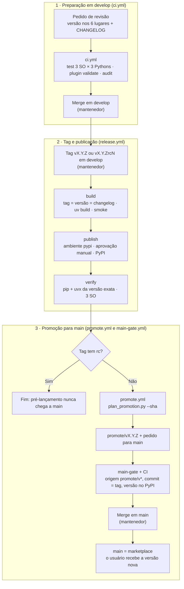

# CI do versionamento: como uma versão chega do `develop` até o `main`

Visão geral do que cada workflow faz, em que ordem e onde entra o mantenedor.
Os comandos passo a passo estão em [RELEASING.md](RELEASING.md); o motivo de
cada regra está no [ADR-0020](adrs/0020-fluxo-de-branches-e-release.md).

## Diagrama

Arquivo editável no draw.io: [`diagramas/ci-versionamento.drawio`](diagramas/ci-versionamento.drawio)
(abrir em app.diagrams.net ou na extensão do draw.io do editor).

O mesmo fluxo em Mermaid, que o GitHub desenha direto nesta página:

## Etapa por etapa

### 1. Preparação em `develop` (`ci.yml`)

Toda mudança entra em `develop` por pedido de revisão. O `ci.yml` roda em
`push` e em pedido para `main` e `develop`, com três jobs:

| Job | O que confere |
|---|---|
| `test` | `pytest`, `ruff check` e `ruff format --check` em Ubuntu, macOS e Windows, com Python 3.11, 3.12 e 3.13 |
| `plugin` | `claude plugin validate` do `./plugin` e do marketplace |
| `audit` | `pip-audit` nas dependências travadas |

Num pedido de versão, a versão muda em seis lugares (`__version__`, os quatro
manifestos do plugin e o `args` do servidor no manifesto do Claude) e o
`CHANGELOG.md` ganha a seção `[X.Y.Z]`. O teste `test_release_consistency.py`
confere que os seis valores batem.

### 2. Tag e publicação (`release.yml`)

O mantenedor cria a tag `vX.Y.Z` (ou `vX.Y.ZrcN`) **em `develop`** e envia. O
`release.yml` dispara por `push` de tag `v*`:

1. **`build`**: `check_release_tag.py` confere a tag contra `__version__` e o
   changelog, `uv build` gera o pacote e um smoke test sobe o servidor
   instalado do wheel, sem carteira, e conta as 20 tools. Sem `id-token`.
2. **`publish`**: ambiente `pypi`, com aprovação manual do mantenedor a cada
   execução. É o único job com `id-token: write` (publicação confiável por
   OIDC).
3. **`verify`**: em Ubuntu, macOS e Windows, instala a versão exata do PyPI
   com `pip` e roda com `uvx`, repetindo o smoke test. Tenta por até cerca de
   cinco minutos, porque o índice demora a mostrar a versão nova.

Se falhar **antes** do `publish`, corrige-se em `develop`, apaga-se a tag e
cria-se de novo. Se falhar **depois**, o número já existe no PyPI e não se
reutiliza: sobe-se a versão.

### 3. Promoção para `main` (`promote.yml` e `main-gate.yml`)

`main` só recebe versões já publicadas, porque é o que o marketplace entrega.

1. O `promote.yml` dispara quando o `Release` termina com sucesso. O
   `plan_promotion.py --sha` acha a tag final no commit do release. Tag com
   `rc` não é promovida: o workflow responde "nada a promover".
2. Para versão final, ele cria `promote/vX.Y.Z` no commit da tag e abre o
   pedido para `main`. Se o commit da tag não está em `develop` (hotfix), abre
   também um pedido para `develop`.
3. O pedido é aberto com o `GITHUB_TOKEN`, então o GitHub deixa os runs do
   `pull_request` esperando aprovação: o mantenedor aprova o `main-gate` e a CI
   na aba Checks.
4. O `main-gate` roda `check_promotion.py` e só aceita pedido de origem
   `promote/vX.Y.Z`, cujo commit seja o da tag, com a versão igual nos
   manifestos e já existente no índice. Índice inacessível falha fechado.
5. O mantenedor faz o merge. Só então o marketplace entrega a versão nova.

A automação cria branches e abre pedidos, nunca faz merge.

## O que fica fora do fluxo de versão

- **`live.yml`**: alarme semanal contra a API real do Investidor10, não é
  portão de release (ADR-0005, emenda de 2026-11-14).
- **`dependabot.yml`**: abre pedidos de atualização contra `develop`, com
  `cooldown` de 7 dias.

## Limite atual: a primeira promoção é à mão

O GitHub só dispara `workflow_run`, `schedule` e `workflow_dispatch` com o
workflow na branch padrão (`main`). Até a primeira versão final chegar a `main`,
o `promote.yml` e o `live.yml` não rodam sozinhos, e a promoção da 0.4.0 é feita
com `python3 scripts/plan_promotion.py --tag v0.4.0 --apply`. Ver a lição
[workflows de evento só valem na branch padrão](learning-lessons/workflows_de_evento_so_valem_na_branch_padrao.md).
